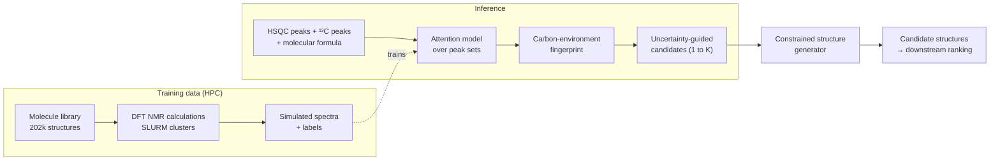
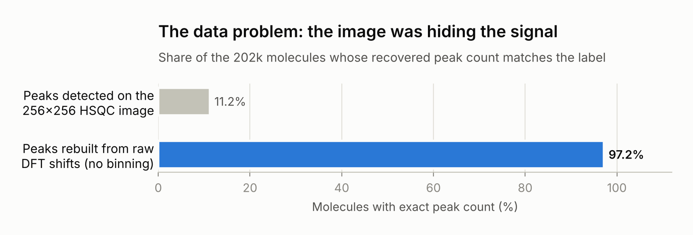
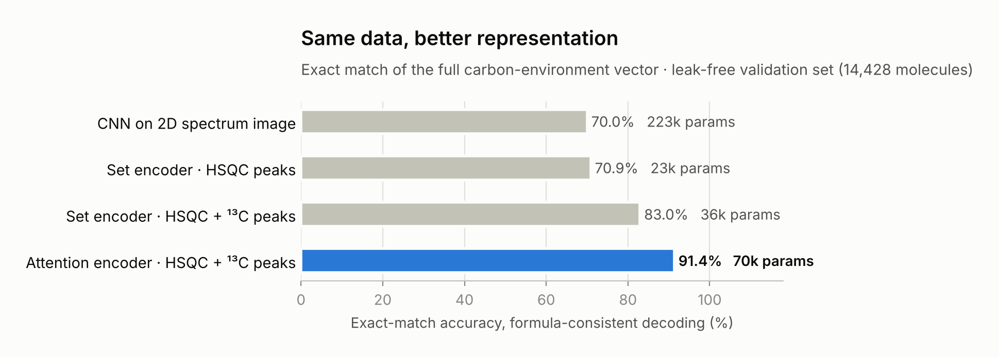
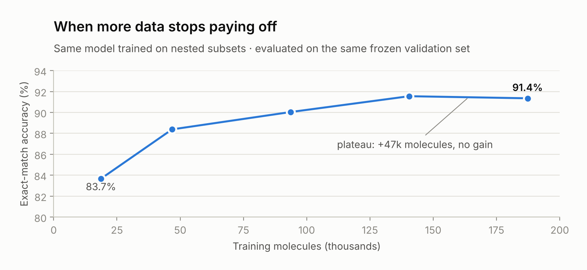
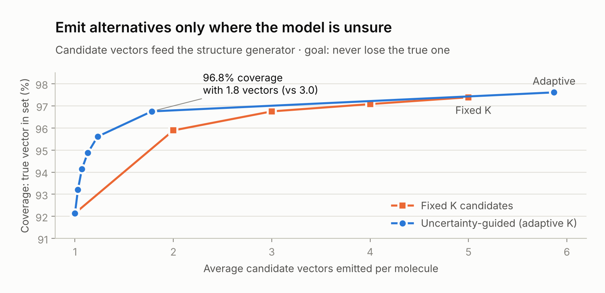

# From NMR spectra to molecular structure with deep learning

**A data-first approach to computer-assisted structure elucidation**

**English** · [Español](README_ES.md)

PhD thesis work · Lucas Passaglia · IQUIR–CONICET / Universidad Nacional de Rosario (UNR) · Rosario, Argentina · 2026

> ℹ️ **This is a showcase repository.** The code, trained models and dataset belong to an institutional project under active development and are not public. Class definitions, architecture details and hyperparameters are intentionally left out. Happy to walk through the work in an interview.

`#DeepLearning` `#NMR` `#Cheminformatics` `#StructureElucidation` `#HPC` `#AgenticAI`

---

## Overview

Identifying an unknown organic compound still comes down to an expert reading NMR spectra and proposing structures. Automatic structure generators can enumerate candidates, but the space of molecules consistent with a molecular formula is combinatorially huge.

This project puts a deep-learning model in front of the generator. The model reads a **2D HSQC spectrum**, the **¹³C peak list** and the **molecular formula**, and predicts the molecule's **carbon-environment fingerprint**: how many carbons of each chemical type it contains. The fingerprint is a hard constraint for the structure generator, which then only explores structures consistent with the spectra.

> **In one line:** a DFT-computed dataset of 202k molecules, a leak-free evaluation protocol and a set-based attention model that predicts the full carbon fingerprint exactly for 91% of held-out molecules, and keeps the true answer among its candidates for ~97%.

---

## The data problem

Most of the work in this project went into the data, not the model. Four problems had to be solved before any architecture choice mattered.

### 1 · No labelled data at scale

Experimental 2D NMR spectra with assigned structures are scarce and heterogeneous, nowhere near enough to train a deep model. I built a synthetic training set instead: **202,465 molecules with DFT-computed ¹H and ¹³C chemical shifts**, generated and relaunched in batch on SLURM clusters. A second batch of 58k molecules from diverse scaffolds brought in substantially more nitrogen-containing and sp² chemistry than the first one.

### 2 · Leakage between training and validation

Random splits let near-duplicate molecules land on both sides. I replaced them with a **frozen validation set of 14,428 molecules**, deduplicated by canonical SMILES, with zero train/validation overlap, and the same split and seed for every experiment. Along the way this exposed an earlier validation score that looked great only because ~90% of that set had been seen in training.

### 3 · The representation was destroying information

The first models read spectra as **256×256 images**. At that resolution, peaks closer than ~3.5 ppm in ¹³C or ~0.25 ppm in ¹H merge into one blob, so **in 89% of molecules the image could not show every peak**, whatever model read it. Rebuilding peak lists directly from the raw DFT shifts, and collapsing symmetry-equivalent carbons the way a real spectrum does, recovered the exact peak count for **97%** of molecules.

### 4 · Physics the input could not see

HSQC only shows carbons bonded to hydrogen, so **quaternary carbons are invisible**, and a class audit showed that quaternary sp² carbons are the *most frequent* class in the dataset, not a rare one. Adding the ¹³C peak list as a second input set, and letting an attention model compare both sets, broke the confusion that had survived five earlier architectures: the error rate on quaternary sp² carbons dropped from **13.5% to 1.2%** of molecules.

---

## Results

All numbers are on the frozen, leak-free validation set (14,428 molecules). The metric is **exact match of the full fingerprint** after formula-consistent decoding: one wrong count in any class makes the whole molecule wrong.

### Same data, better representation

The best model reaches **91.4%** exact match with **70k parameters**; the image-based CNN baseline had **8.6M**.

### Knowing when more data stops helping

Training the same model on nested subsets shows a **data plateau**: the last 47k molecules add nothing measurable. A separate run with a different output head and 2.5× longer training did not help either. Both point the same way: the remaining error is a limit of the **information** in the input, not of data volume or optimisation. That is a decision worth making with evidence before spending months of cluster time on a larger dataset.

### Candidates, not a single guess

The fingerprint is not the final answer, it is a filter for the structure generator. Losing the true fingerprint is costly, while emitting two or three alternatives is cheap. So the right metric is **coverage**: is the true fingerprint among the candidates?

Emitting alternatives **only where the model is uncertain** reaches **96.8% coverage with 1.8 candidates per molecule**, where a fixed-K strategy needs 3.0. For the ~92% of molecules the model gets right, it emits a single fingerprint.

### A harder target that matches the generator

The generator counts *every* carbon, while spectra collapse symmetry-equivalent ones (benzene: one signal, six carbons). A second model predicts **total carbon counts** by using ¹H integration as an extra peak feature. Integration is worth **+5.3 points** (90.4% vs 85.0% without it), and with uncertainty-guided candidates this version reaches **94.2% coverage at 1.37 candidates per molecule**. It is the version designed to plug into the structure generator.

> **Scope, stated plainly:** all metrics above are on DFT-simulated spectra. Validation on experimental spectra is the current step; an inference tool that takes experimental peak lists is already built.

---

## Example: what the model is asked to do

An illustrative case with ibuprofen (C₁₃H₁₈O₂), using **simplified, public carbon classes**, not the project's class set. Derived by hand to show the task, not model output.

| Carbon environment | Carbons | Signals | Seen in HSQC? |
|---|:---:|:---:|:---:|
| CH₃ (aliphatic) | 3 | 2 | ✅ |
| CH₂ (aliphatic) | 1 | 1 | ✅ |
| CH (aliphatic) | 2 | 2 | ✅ |
| CH (aromatic) | 4 | 2 | ✅ |
| C quaternary (aromatic) | 2 | 2 | ❌ ¹³C only |
| C=O (carboxylic acid) | 1 | 1 | ❌ ¹³C only |
| **Total** | **13** | **10** | 7 cross-peaks |

Two things make this hard, and both are visible in one molecule. **Three carbons are invisible in HSQC** (quaternary), which is why the ¹³C set matters. **Symmetry hides three more** (the two isobutyl methyls and the two pairs of aromatic CH each give one signal), which is why integration matters for the total-carbon target. The molecular formula ties it together: the counts must add up to C₁₃.

<!--
  Lucas: acá va el ejemplo REAL, que es lo que más vende.
  Abrí tu GUI de inferencia, cargá una molécula pública (no del dataset de la organización)
  y grabá un GIF corto (ScreenToGif en Windows) o una captura:
    espectro/picos de entrada → vector predicho → candidatos.
  Guardalo como figures/05_inference_demo.gif y descomentá la línea de abajo.

-->

---

## How it was built

**Compute.** DFT data generation on CPU clusters; training on **NVIDIA A10 (CUDA)** and on **Intel Data Center GPU Max 1550 (XPU)** at the Clementina XXI national supercomputer. The training code is device-agnostic; CPU↔XPU numerical-parity tests (differences ~10⁻⁷) were run before trusting any result, and both platforms reproduce the same model quality.

**Experiment discipline.** One change per experiment. Frozen validation set and seed. Decision criteria, and in some cases the expected outcome, written down **before** running. Negative results stay in the log: a regularisation run that underfit, an output head that did not help, a hypothesis about rare classes that the data refuted. More than a dozen experiments in about a month, each with a written rationale and a verdict.

**Agentic workflow.** Built with Claude Code as a research collaborator inside a structured loop: a persistent project context that encodes rules learned from real bugs (for example, silent data-loader deadlocks with HDF5, or class-order misalignments that train garbage without raising an error), then design spec → implementation plan → unit and smoke tests → SLURM job → results log. The human decides what to test and what counts as success; the agent makes each iteration fast and reproducible.

**Stack.** Python · PyTorch · NumPy · pandas · h5py · RDKit · Matplotlib · SLURM · CUDA · Intel oneAPI/XPU · Gaussian 16 · Claude Code

---

## Code availability

The code, trained weights and data are part of an institutional project and are not public. This repository contains only text and figures produced for this showcase. If you are evaluating my work, I am happy to discuss the methods in detail.

## Author

**Lucas Passaglia** · PhD candidate in Chemical Sciences · IQUIR–CONICET / UNR
Computational chemistry · deep learning for NMR · HPC · agentic AI workflows

[GitHub](https://github.com/Elpasu) · [LinkedIn](https://www.linkedin.com/in/passaglialucas/)
