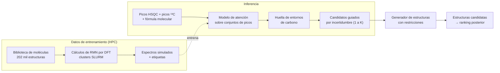

# Del espectro de RMN a la estructura molecular con deep learning

**Un enfoque centrado en los datos para la elucidación estructural asistida por computadora**

[English](README.md) · **Español**

Trabajo de tesis doctoral · Lucas Passaglia · IQUIR–CONICET / Universidad Nacional de Rosario (UNR) · Rosario, Argentina · 2026

> ℹ️ **Este es un repositorio de muestra (showcase).** El código, los modelos entrenados y el dataset pertenecen a un proyecto institucional en desarrollo y no son públicos. Las definiciones de clases, los detalles de arquitectura y los hiperparámetros se omiten a propósito. Con gusto lo explico en detalle en una entrevista.

`#DeepLearning` `#RMN` `#Quimioinformática` `#ElucidaciónEstructural` `#HPC` `#IAAgéntica`

---

## Resumen

Identificar un compuesto orgánico desconocido todavía depende de que un experto lea espectros de RMN y proponga estructuras. Los generadores automáticos de estructuras pueden enumerar candidatos, pero el espacio de moléculas compatibles con una fórmula molecular es combinatoriamente enorme.

Este proyecto pone un modelo de deep learning delante del generador. El modelo lee un **espectro HSQC 2D**, la **lista de picos de ¹³C** y la **fórmula molecular**, y predice la **huella de entornos de carbono** de la molécula: cuántos carbonos de cada tipo químico contiene. Esa huella funciona como restricción dura para el generador, que solo explora estructuras compatibles con los espectros.

> **En una línea:** un dataset de 202 mil moléculas calculadas por DFT, un protocolo de evaluación sin fugas y un modelo de atención sobre conjuntos de picos que predice exactamente la huella completa en el 91 % de las moléculas de validación, y conserva la respuesta correcta entre sus candidatos en ~97 %.

---

## El problema de datos

La mayor parte del trabajo estuvo en los datos, no en el modelo. Hubo que resolver cuatro problemas antes de que la elección de arquitectura importara.

### 1 · No hay datos etiquetados a escala

Los espectros experimentales de RMN 2D con estructura asignada son escasos y heterogéneos, muy lejos de lo necesario para entrenar un modelo profundo. Construí en cambio un set de entrenamiento sintético: **202.465 moléculas con desplazamientos químicos de ¹H y ¹³C calculados por DFT**, generados y relanzados por lotes en clusters SLURM. Un segundo lote de 58 mil moléculas de scaffolds diversos sumó bastante más química nitrogenada y sp² que el primero.

### 2 · Fugas entre entrenamiento y validación

Los splits aleatorios dejaban moléculas casi duplicadas a ambos lados. Los reemplacé por un **set de validación congelado de 14.428 moléculas**, deduplicado por SMILES canónico, con solapamiento cero entre entrenamiento y validación, y el mismo split y semilla en todos los experimentos. En el camino esto expuso un puntaje de validación anterior que se veía excelente solo porque ~90 % de ese set había sido visto en el entrenamiento.

### 3 · La representación destruía información

Los primeros modelos leían los espectros como **imágenes de 256×256**. A esa resolución, picos a menos de ~3,5 ppm en ¹³C o ~0,25 ppm en ¹H se funden en una sola mancha, así que **en el 89 % de las moléculas la imagen no podía mostrar todos los picos**, sin importar qué modelo la leyera. Reconstruir las listas de picos directamente desde los desplazamientos DFT crudos, colapsando los carbonos equivalentes por simetría como lo hace un espectro real, recuperó el número exacto de picos en el **97 %** de las moléculas.

### 4 · Física que el input no podía ver

El HSQC solo muestra carbonos unidos a hidrógeno, así que **los carbonos cuaternarios son invisibles**, y una auditoría de clases mostró que los cuaternarios sp² son la clase *más frecuente* del dataset, no una rara. Agregar la lista de picos de ¹³C como segundo conjunto de entrada, y dejar que un modelo de atención compare ambos conjuntos, rompió la confusión que había sobrevivido a cinco arquitecturas anteriores: el error en cuaternarios sp² bajó del **13,5 % al 1,2 %** de las moléculas.

---

## Resultados

Todos los números son sobre el set de validación congelado y sin fugas (14.428 moléculas). La métrica es **acierto exacto de la huella completa** tras una decodificación consistente con la fórmula: un solo conteo mal en cualquier clase hace que toda la molécula cuente como error.

> Las figuras están en inglés (usan punto decimal).

### Mismos datos, mejor representación

El mejor modelo llega a **91,4 %** de acierto exacto con **70 mil parámetros**; la CNN de referencia sobre imágenes tenía **8,6 millones**.

### Saber cuándo más datos dejan de servir

Entrenar el mismo modelo sobre subconjuntos anidados muestra una **meseta de datos**: las últimas 47 mil moléculas no aportan nada medible. Una corrida aparte con otra cabeza de salida y 2,5 veces más entrenamiento tampoco mejoró. Las dos evidencias apuntan a lo mismo: el error restante es un límite de la **información** del input, no del volumen de datos ni de la optimización. Es una decisión que conviene tomar con evidencia antes de gastar meses de cluster en un dataset más grande.

### Candidatos, no una sola apuesta

La huella no es la respuesta final, es un filtro para el generador de estructuras. Perder la huella correcta es caro; emitir dos o tres alternativas es barato. Por eso la métrica correcta es la **cobertura**: ¿está la huella verdadera entre los candidatos?

Emitir alternativas **solo donde el modelo duda** llega a **96,8 % de cobertura con 1,8 candidatos por molécula**, donde una estrategia de K fijo necesita 3,0. Para el ~92 % de moléculas en las que el modelo acierta, emite una sola huella.

### Un objetivo más difícil, compatible con el generador

El generador cuenta *todos* los carbonos, mientras que los espectros colapsan los equivalentes por simetría (benceno: una señal, seis carbonos). Un segundo modelo predice **conteos de carbonos totales** usando la integración de ¹H como feature adicional de cada pico. La integración aporta **+5,3 puntos** (90,4 % vs 85,0 % sin ella) y, con candidatos guiados por incertidumbre, esta versión llega a **94,2 % de cobertura con 1,37 candidatos por molécula**. Es la versión diseñada para conectarse al generador de estructuras.

> **Alcance, dicho claramente:** todas las métricas de arriba son sobre espectros simulados por DFT. La validación con espectros experimentales es la etapa actual; ya está construida una herramienta de inferencia que toma listas de picos experimentales.

---

## Ejemplo: qué se le pide al modelo

Un caso ilustrativo con ibuprofeno (C₁₃H₁₈O₂), usando **clases de carbono simplificadas y públicas**, no las del proyecto. Derivado a mano para mostrar la tarea, no es una salida del modelo.

| Entorno de carbono | Carbonos | Señales | ¿Se ve en HSQC? |
|---|:---:|:---:|:---:|
| CH₃ (alifático) | 3 | 2 | ✅ |
| CH₂ (alifático) | 1 | 1 | ✅ |
| CH (alifático) | 2 | 2 | ✅ |
| CH (aromático) | 4 | 2 | ✅ |
| C cuaternario (aromático) | 2 | 2 | ❌ solo ¹³C |
| C=O (ácido carboxílico) | 1 | 1 | ❌ solo ¹³C |
| **Total** | **13** | **10** | 7 picos cruzados |

Las dos dificultades aparecen en una sola molécula. **Tres carbonos son invisibles en HSQC** (cuaternarios): por eso importa el conjunto de ¹³C. **La simetría esconde otros tres** (los dos metilos del isobutilo y los dos pares de CH aromáticos dan una señal cada uno): por eso importa la integración para el objetivo de carbonos totales. La fórmula molecular lo cierra: los conteos tienen que sumar C₁₃.

<!--
  Lucas: acá va el ejemplo REAL, que es lo que más vende.
  Abrí tu GUI de inferencia, cargá una molécula pública (no del dataset de la organización)
  y grabá un GIF corto (ScreenToGif en Windows) o una captura:
    espectro/picos de entrada → vector predicho → candidatos.
  Guardalo como figures/05_inference_demo.gif y descomentá la línea de abajo.

-->

---

## Cómo se construyó

**Cómputo.** Generación de datos DFT en clusters de CPU; entrenamiento en **NVIDIA A10 (CUDA)** y en **Intel Data Center GPU Max 1550 (XPU)** en el supercomputador nacional Clementina XXI. El código de entrenamiento es agnóstico al dispositivo; antes de confiar en cualquier resultado se corrieron tests de paridad numérica CPU↔XPU (diferencias ~10⁻⁷), y ambas plataformas reproducen la misma calidad de modelo.

**Disciplina experimental.** Un cambio por experimento. Set de validación y semilla congelados. Criterios de decisión, y en algunos casos el resultado esperado, escritos **antes** de correr. Los resultados negativos quedan en el registro: una regularización que subajustó, una cabeza de salida que no ayudó, una hipótesis sobre clases raras que los datos refutaron. Más de una docena de experimentos en alrededor de un mes, cada uno con su justificación escrita y su veredicto.

**Flujo agéntico.** Desarrollado con Claude Code como colaborador de investigación dentro de un ciclo estructurado: un contexto de proyecto persistente con reglas aprendidas de bugs reales (por ejemplo, bloqueos silenciosos del data loader con HDF5, o desalineaciones en el orden de clases que entrenan basura sin tirar error), y después especificación → plan de implementación → tests unitarios y de humo → job de SLURM → registro de resultados. La persona decide qué probar y qué cuenta como éxito; el agente hace que cada iteración sea rápida y reproducible.

**Stack.** Python · PyTorch · NumPy · pandas · h5py · RDKit · Matplotlib · SLURM · CUDA · Intel oneAPI/XPU · Gaussian 16 · Claude Code

---

## Disponibilidad del código

El código, los pesos entrenados y los datos forman parte de un proyecto institucional y no son públicos. Este repositorio contiene solo texto y figuras producidas para esta muestra. Si estás evaluando mi trabajo, con gusto discuto los métodos en detalle.

## Autor

**Lucas Passaglia** · Doctorando en Ciencias Químicas · IQUIR–CONICET / UNR
Química computacional · deep learning para RMN · HPC · flujos de trabajo con IA agéntica

[GitHub](https://github.com/Elpasu) · [LinkedIn](https://www.linkedin.com/in/passaglialucas/)
